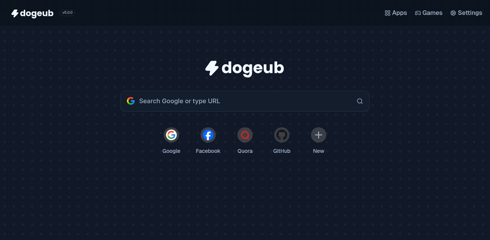

<div align="center">
  
  
  <br />

  <hr />
  DogeUB (Doge Unblocker) version 5 is finally here!

  
  <br />
  <br />

  


</div>

## Overview

DogeUB is a modern web proxy frontend and internet browsing hub, allowing you to browse the web anonymously while providing a full suite of apps and games, built with [React](https://github.com/facebook/react).

> [!IMPORTANT]
> Please consider starring our repository if you are forking it!

### Features:

- **Performance:** Fast, lightweight, and highly responsive.
- **Tabs:** Browse multiple sites with ease, providing an experience similar to a web browser!
- **Customization:** Multiple themes, extensive settings, and user-tailored experience.

---

## Development & Building


### Production:
```bash
git clone https://github.com/DogeNetwork/dogeub.git
cd dogeub
npm i
npm run build
node server.js
````

### Development:

```bash
git clone https://github.com/DogeNetwork/dogeub.git
cd dogeub
npm i
npm run dev
```

---

## AI Configuration

The Leopard AI chat uses a secure server-side proxy (`/api/ai`).

- Edit provider models, endpoints, defaults, and tool behavior in one place:
  - `src/data/aiConfig.js`
- Add your API keys to a `.env` file in the project root (server-only — never exposed to users). Restart the server after changes.

Example `.env`:

```
# Choose which provider the server uses by default: openai | openrouter | gemini | groq
AI_PROVIDER=openai

# OpenAI
OPENAI_API_KEY=sk-xxx
OPENAI_MODEL=gpt-4o-mini
OPENAI_ALLOWED_MODELS=gpt-4o-mini,gpt-4o,o4,o4-mini
# Optional web-search mode overrides
OPENAI_MODEL_WEB=o4
OPENAI_ALLOWED_MODELS_WEB=gpt-4o-mini,gpt-4o,o4,o4-mini

# OpenRouter (OpenAI-compatible endpoint)
OPENROUTER_API_KEY=or-xxx
OPENROUTER_MODEL=openai/gpt-4o-mini
OPENROUTER_ALLOWED_MODELS=openai/gpt-4o-mini,anthropic/claude-3.5-sonnet
# Optional web-search mode overrides (if web search is toggled, provider switches to WEBSEARCH_PROVIDER)
WEBSEARCH_PROVIDER=gemini
OPENROUTER_MODEL_WEB=openai/gpt-4o
OPENROUTER_ALLOWED_MODELS_WEB=openai/gpt-4o-mini,openai/gpt-4o,anthropic/claude-3.5-sonnet
# Optional, helps with OpenRouter dashboards/limits
SITE_URL=https://your-domain.example
SITE_TITLE=Leopard AI

# Gemini (Google)
GEMINI_API_KEY=ya29.xxx
GEMINI_MODEL=gemini-1.5-flash
GEMINI_ALLOWED_MODELS=gemini-1.5-flash,gemini-1.5-pro
# Optional web-search mode overrides
GEMINI_MODEL_WEB=gemini-1.5-pro
GEMINI_ALLOWED_MODELS_WEB=gemini-1.5-flash,gemini-1.5-pro

# Groq (OpenAI-compatible endpoint)
GROQ_API_KEY=gsk_xxx
GROQ_MODEL=llama-3.1-70b-versatile
GROQ_ALLOWED_MODELS=llama-3.1-70b-versatile,llama-3.1-8b-instant,mixtral-8x7b-32768,gemma2-9b-it
# Optional web-search mode overrides
GROQ_MODEL_WEB=llama-3.1-70b-versatile
GROQ_ALLOWED_MODELS_WEB=llama-3.1-70b-versatile,llama-3.1-8b-instant,mixtral-8x7b-32768,gemma2-9b-it
```

Notes:
- Keys are only read by `server.js` via `dotenv` and never sent to the browser.
- The UI model dropdown is defined in `src/data/models.js`. Edit that file to control the list and labels shown. When using OpenRouter, Gemini, or Groq, ensure your selected model id matches what that provider expects, or set a fallback model via `*_MODEL` and optionally `*_MODEL_WEB`.
- You can also pass a `provider` in the request body if you want to override the default for a specific call (e.g., `{ provider: 'gemini' }`). If omitted, the server uses `AI_PROVIDER`.
 - When Web Search is toggled on in the UI, the server prefers the `*_MODEL_WEB` fallback for the active provider (if set). With OpenAI and no explicit web fallback, it gently steps up the model (Mini → o4‑mini → o4). If the active provider is `openrouter`, the server switches to `WEBSEARCH_PROVIDER` (default: gemini) for tool-enabled runs.


## Contributors / Developers

| Name          | Role               | GitHub |
| ------------- | ------------------ | ------ |
| Derpman | Lead Developer     |      [@stellarcase](https://github.com/stellarcase) |
| Fowntain | Lead Developer | [@fowntain](https://github.com/fowntain)     |
| Akane | Contributor | [@genericness](https://github.com/genericness)     |


> [!NOTE]
> Want to be on this list? Make a pull request!

---

### Made possible thanks to:

* [MercuryWorkshop/wisp-server-node](https://github.com/MercuryWorkshop/wisp-server-node)
* [MercuryWorkshop/scramjet](https://github.com/MercuryWorkshop/scramjet)
* [titaniumnetwork-dev/Ultraviolet](https://github.com/titaniumnetwork-dev/Ultraviolet)
* [lucide-icons/lucide](https://github.com/lucide-icons/lucide)

## License

This project is licensed under the **Genuerro Afro V3 License**.  
See the [LICENSE](LICENSE) file for more details.
